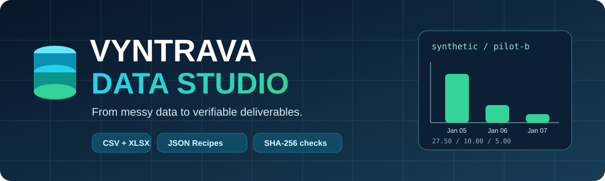
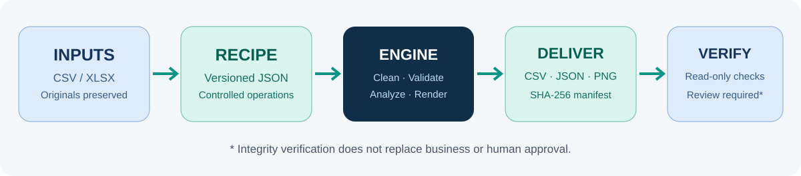
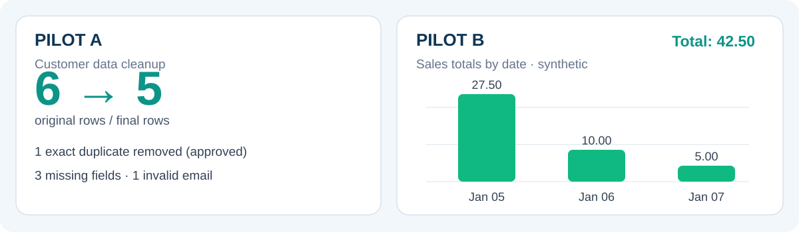

<div align="center">



# Vyntrava Data Studio

**De datos desordenados a resultados reproducibles y verificables.**

Motor local en Python para **importar, diagnosticar, limpiar, validar, analizar y preparar entregas de datos** mediante recetas JSON versionadas, controles de integridad y espacios de trabajo separados por cliente y encargo.


</div>

## ¿Qué problema resuelve?

Muchos trabajos de datos terminan dependiendo de scripts difíciles de reutilizar y resultados imposibles de rastrear. **Vyntrava Data Studio** separa las instrucciones de procesamiento de los archivos originales y registra qué receta y qué entradas produjeron cada entrega.

- **Importación CSV y Excel (.xlsx)** con políticas explícitas y controles de formato.
- **Recetas JSON versionadas** para transformaciones y validaciones deterministas.
- **Diagnóstico de calidad**: duplicados exactos, celdas vacías, espacios sobrantes y estructura.
- **Aprobación HMAC para deduplicación** vinculada a la receta y a las entradas.
- **Análisis y gráficos PNG**: agrupaciones, sumas monetarias con `Decimal` e indicadores.
- **Paquetes verificables**: archivos generados, resúmenes, manifiestos y hashes SHA-256.
- **Verificación de solo lectura** ante archivos alterados, ausentes, extras o inconsistentes.
- **Aislamiento por cliente y encargo**, con preservación de los originales.

> **Alcance:** este es un **prototipo técnico aceptado con reservas y probado con datos sintéticos**, no un servicio autorizado para tratar información real de clientes. La verificación de integridad no acredita corrección comercial ni autenticidad criptográfica del manifiesto. El estado `revision_requerida` exige revisión humana.

## Cómo funciona

<div align="center">

</div>

## Dos ejemplos reproducibles

Los ejemplos están en [`examples/piloto_a`](examples/piloto_a) y [`examples/piloto_b`](examples/piloto_b). Utilizan **datos completamente ficticios**. Cada ejecución crea un encargo nuevo sin modificar los originales.

| Característica | Piloto A: clientes | Piloto B: ventas |
|---|---|---|
| Entrada | 6 registros de clientes ficticios | 6 registros de ventas ficticias |
| Procesamiento | Diagnóstico, deduplicación aprobada, limpieza de espacios y validaciones | Deduplicación aprobada, validación de cantidades, agrupaciones y gráfico |
| Resultado | 5 filas finales, 3 ausencias y 1 correo electrónico inválido | 4 ventas incluidas, 1 excluida, 8 unidades y **42,50** |
| Archivos generados | CSV, resumen JSON y manifiesto | CSV, resumen JSON, gráfico PNG y manifiesto |
| Estado | `revision_requerida` | `revision_requerida` |

<div align="center">

</div>

## Primeros pasos en Windows

**Requisitos:** Python 3.12 y [uv](https://docs.astral.sh/uv/). Desde la raíz del repositorio:

```powershell
uv sync --frozen

# Clave ficticia, válida únicamente para los ejemplos
$env:VYNTRAVA_SYNTHETIC_APPROVAL_KEY = 'clave-ficticia-solo-para-pruebas'
$root = Join-Path $env:TEMP 'vyntrava-data-ejemplos'

# Cada ejecución genera automáticamente un identificador único
uv run --no-sync python -m vyntrava_data_studio.synthetic_lab run --pilot a --root $root --kind first
uv run --no-sync python -m vyntrava_data_studio.synthetic_lab run --pilot b --root $root --kind first

Remove-Item Env:VYNTRAVA_SYNTHETIC_APPROVAL_KEY
```

La salida muestra el identificador del encargo, las rutas, los controles de resultado, los hashes, el estado y los tiempos. Para **verificar** un encargo ya generado, utilizá su identificador:

```powershell
uv run --no-sync python -m vyntrava_data_studio.synthetic_lab verify --pilot b --root $root --job identificador_del_encargo
```

La clave es de demostración y no habilita operaciones con datos reales. Los resultados conservan el estado `revision_requerida` hasta que exista una revisión humana. Si la instalación no puede descargar dependencias, consultá las [guías operativas](docs/OPERACION_S05.md).

## Estructura del proyecto

| Ruta | Contenido |
|---|---|
| `src/vyntrava_data_studio/` | Importación, recetas, limpieza, análisis, gráficos, entregas y verificación |
| `examples/piloto_a/` | Datos sintéticos y receta de clientes |
| `examples/piloto_b/` | Datos sintéticos y receta de ventas |
| `docs/` | Guías de operación y contratos de verificación |
| `tests/` | Pruebas automatizadas |
| `reports/` | Informes técnicos y decisiones de aceptación |
| `SPEC.md` y `PLAN.md` | Contrato técnico y planificación |

## Pruebas y calidad

```powershell
$temporal = Join-Path $env:TEMP ('vyntrava-pruebas-' + [guid]::NewGuid().ToString('N'))
uv run --no-sync python -m pytest -q -rs -p no:cacheprovider --basetemp "$temporal"
```

La última regresión local registrada cerró con **182 pruebas aprobadas y 3 omitidas**; las omisiones correspondieron a pruebas con enlaces simbólicos en el entorno Windows. Es un resultado histórico local, **no una garantía de que futuras ejecuciones pasarán**. El repositorio incluye una automatización de pruebas para comprobar cambios nuevos.

## Metodología de desarrollo

El proyecto siguió **ADEL**: preservación de la arquitectura, especificaciones, desarrollo guiado por pruebas, controles de alcance, trazabilidad y verificación de resultados. Los ciclos técnicos 00 a 05 fueron **aceptados con reservas**.

**Limitaciones conocidas:** revisión humana y medición de tiempos operativos pendientes; publicación multiarchivo no atómica; riesgos residuales de concurrencia y permisos; manifiestos sin firma criptográfica; falta de validación y políticas para trabajar con datos reales. El hecho de que el proyecto sea público no autoriza su uso comercial ni define una licencia de reutilización.

## Documentación

- [Especificación técnica](SPEC.md)
- [Plan y criterios de aceptación](PLAN.md)
- [Operación de los ejemplos](docs/OPERACION_S05.md)
- [Verificación de paquetes](docs/VERIFICACION_S04.md)
- [Operación del motor](docs/OPERACION_S03.md)
- [Política de importación Excel](docs/OPERACION_XLSX_V1.md)

---

<div align="center">

**Desarrollado por Vyntrava Technologies**

*Procesamiento reproducible de datos, trazabilidad y controles de calidad.*

**Demostraciones con datos sintéticos · Prototipo técnico con limitaciones**

</div>
